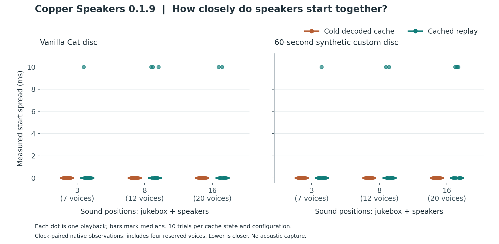
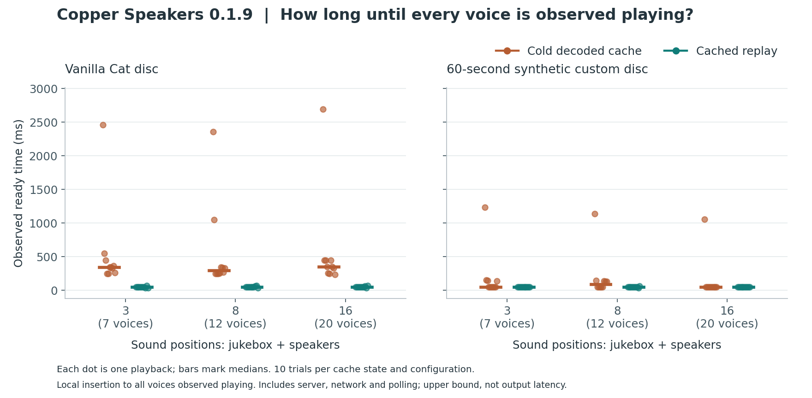

# Copper Speakers

Copper Speakers is a Fabric/Polymer mod for **Minecraft Java Edition 26.3**, for single-player worlds and multiplayer servers. Place a jukebox, lay copper wire, connect speakers, and insert a music disc to play it around your build.

**All vanilla music discs work.** Custom discs that use Minecraft's normal jukebox system also play through connected speakers, using the audio supplied by their mod or resource pack.

## Installation

Install Copper Speakers, **Fabric API**, and **bundled Polymer for Minecraft 26.3**. This release requires Fabric Loader **0.19.5 or newer**, Java **25**, and Polymer **0.18.4 or a later 0.18.x release**.

### Single-player

Put the three mod jars in your Fabric instance's `mods` folder, then open your world. Copper Speakers runs on the integrated server, and Polymer supplies the generated resource pack locally.

### Multiplayer servers

Put the three mod jars in the Fabric server's `mods` folder and restart it. Bundled Polymer includes AutoHost, which generates and serves the resource pack.

Players **do not need Copper Speakers, Fabric, or Polymer installed on their clients** to join. They only need to accept the server resource pack. Players using modded clients can join too; an unmodified client is not a requirement.

Keep Polymer AutoHost enabled and allow its mod-required resource pack setting. Servers behind proxies may need to configure the advertised pack address. After a pack update, reconnect to download the new version.

### Bedrock through Geyser

Bedrock playback is available through the separate **CopperBedrock** compatibility extension and a patched **GeyserDisplayEntity** bridge. Install both extensions, their matching Bedrock resource packs, and the generated block/item mappings on the server. Bedrock players accept the server packs; no client mod is required. Installing the Copper Speakers mod alone does not provide this integration.

The tested setup is Minecraft Java **26.3**, Geyser-Fabric **2.12.1-b1273**, and Bedrock **26.60** (protocol **2225**). Speaker range extension, including custom music, has been confirmed in game on Java and Bedrock. The companion handles buffered audio, prepared joining events, wire and resin geometry, wall-plate entities, and speaker-note particles. It uses Geyser internals, so other Geyser builds or Bedrock protocols need their own checks.

With the compatibility bundle installed, core playback and speaker range extension have been confirmed in game. Relative timing between Bedrock audio sources is under investigation; Java timing benchmarks do not establish Bedrock synchronization. The socket-face restriction below applies on both editions. All 45 Minecraft tests and four graph tests pass. See [Bedrock support](compat/bedrock/README.md) for build and installation instructions, pinned dependencies, and verification limits.

## Build your first system

1. Craft a speaker and some copper wire.
2. Place a jukebox and speaker on the floor, with a continuous wire route between their sides.
3. Stand near the jukebox or speaker and insert a music disc.
4. Add speakers along the route to play the same disc elsewhere in the build. Eject the disc to stop the group.

One jukebox supplies the network; speakers do not hold their own discs. Normal insertion, ejection, hoppers, comparators and redstone behavior are preserved.

### Recipes

| Item | Recipe | Output |
| --- | --- | --- |
| Copper wire | Three copper ingots in a horizontal row | 12 wire |
| Speaker | Paper above a note block, with copper ingots to its left, right and below | 1 speaker |
| Wall plate | Copper ingots in both outer columns, with copper wire in the center | 2 wall plates |

Collect copper and a note block to unlock the corresponding recipe-book entries.

## Wiring

- Place wire on a solid top surface or a hopper. It connects horizontally and follows one-block steps, like redstone dust. Put wire below and on top of the ledge and leave headroom over the lower wire.
- Jukeboxes, speakers and wall plates connect to wire at the same height. Unsupported vertical runs and jumps taller than one block do not connect.
- Wire carries music; it does not power or connect to redstone dust.
- Speakers face toward the player when placed. Music notes travel out of the front while playing; facing affects the visuals, not the listening range.

### Through walls

Use a wall plate on a full, solid block to fit sockets on its opposite faces. Only those two socket faces connect to wire or speakers at the same height; cable beside either unsocketed face stays disconnected. A speaker can sit directly against either socket without a wire segment between them; either the speaker or the plate can be placed first. Plate adjoining full blocks to extend the route through thicker walls, with both socket pairs aligned along the connection.

Side clicks select the plate's direction; top or bottom clicks use the player's horizontal facing. Partial blocks, fluids, block entities and speakers cannot host plates. Punch either exposed plate to remove the pair and recover the item in survival.

### Insulation

Right-click wire with a **resin clump** to insulate it. Bare wire washes away in water; insulated wire survives and can be waterlogged with a water source. Rain does not affect playback.

Use a bucket to drain waterlogged wire. Right-click dry insulated wire with an **axe** to strip it without breaking the cable or interrupting music. This uses one durability in survival and does not return resin. Mining insulated wire in survival drops one wire and one resin clump.

## Discs and playback

Every built-in disc works without conversion or special speaker items. Custom discs work when they use the standard jukebox song system and their audio is available to the client. Install the disc's own mod, datapack and resource pack as normally required; Copper Speakers does not supply their music or remove their dependencies.

Built-in songs use buffered audio for closer alignment between speakers. Other songs retain their own audio settings unless their pack provides an optional buffered alias. **Streamed custom songs can have more timing variation** and consume streaming sound channels; playback is supported without claiming sample-accurate synchronization. Pack authors can find the optional buffering format in [Audio compatibility](docs/audio.md).

- Players already in the dimension can walk or teleport into range during playback, even if they were far away when the disc started.
- With [prepared joining audio](docs/late-listeners.md), players who connect later or return from another dimension join the current song position after a short wait. Existing listeners keep playing continuously. This uses ordinary resource packs; no client mod is required.
- Without prepared audio for that track, a new connection or dimension change still requires a fresh insertion. All normal discs remain playable through speakers.
- If a speaker was connected at the start, up to **four additional speakers at a time** can join during that track. Disconnecting one of these frees its slot. Further speakers wait for a slot or the next insertion.
- The first active jukebox owns a connected network. A second disc on that network waits silently and must be ejected and reinserted to start its own group.
- Copper Speakers does not keep chunks loaded. Unloading the main jukebox ends its session; returning or restarting the game does not resume it.
- Large groups can reach the client's sound-channel limit. Networks are limited to **4,096 nodes**; an oversized network leaves the jukebox playing alone.

Buffered songs must decode before they begin, and long songs can take more time and client memory. Ejection, hopper extraction or immediate replacement stops any remaining audio, including a delayed ending. See [Audio compatibility](docs/audio.md) for the playback model and limits.

## Creative demo

With commands enabled, run:

```mcfunction
/function copper_speakers:demo
```

This **replaces an 11 by 7 by 4 area** around and below the command position with a platform, jukebox, cable and four speakers, then gives the player supplies. Use it in an empty area and insert the supplied Cat disc.

## Building and development

With a Java 25 JDK:

```powershell
./gradlew.bat build
```

The release jar is `build/libs/copper-speakers-0.2.1+mineandcraft.1.jar`. The build runs graph unit tests and Fabric server GameTests. Test fixtures and audio observation code are excluded from the release jar.

See [Development](docs/development.md) for local launches, client checks and asset generation. Bedrock requires the separate compatibility setup described above; the Java client benchmarks below do not measure Bedrock timing.

## Benchmarks

The **0.2.0 late-listener benchmark** uses two separate clients and the packaged server mod. It checks late login, entering range, uninterrupted existing sources, speaker attachment, dimension return and independent networks.


[Measurements, full attempt audit and reproduction instructions](docs/benchmarks/late-listeners/README.md). These are local observations; network and client stalls can increase the difference between listeners.

The **0.1.9 benchmark** exercises actual disc insertion and production playback packets at 3, 8 and 16 sound positions, including the four reserved voices. It compares repeated cold-cache starts and cached replays for a vanilla disc and a synthetic custom disc with a buffered alias.





These are instrumented client measurements on one machine, not a sample-accurate guarantee or a streamed-disc benchmark. [Results, memory measurements, limitations and reproduction instructions](docs/benchmarks/README.md) include every trial and failed launch attempt.

## License

[MIT](LICENSE). Minecraft and dependency assets retain their respective licenses.
