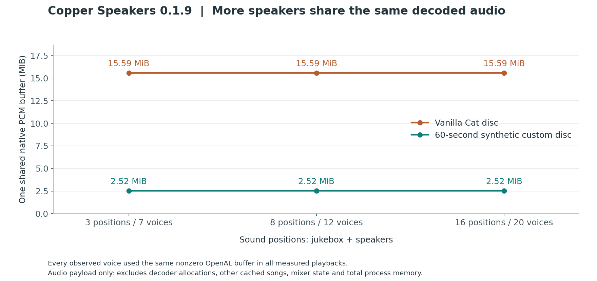

# Copper Speakers 0.1.9 benchmarks

These measurements exercise **Copper Speakers 0.1.9**, Minecraft 26.3 and the production jukebox-to-speaker playback path. They were collected on 26 October 2026. The earlier standalone audio experiment is not used in these figures.

All six configurations completed on their first attempt: **120 successful playbacks**, with no diagnostic JVM flags. Every configuration had a median start spread of **0 ms**; the worst observed spread was approximately **10 ms** on cached replays. The intentional 50 ms observer controls measured 49.9998–50.0002 ms. This describes the observed runs, not a guarantee for other machines or songs.

## What was measured

Each configuration has one jukebox and either 2, 7 or 15 speakers: **3, 8 or 16 sound positions**. The mod also starts four reserved voices, so the observer checks **7, 12 or 20 native audio channels**. Ten rounds alternate an empty decoded cache and a cached replay, giving 20 playbacks per configuration and 120 across two songs.

The songs are the vanilla Cat disc and a 60-second, 440 Hz synthetic custom disc with a valid buffered alias. Both use the actual registered jukebox song, physical wire network and production packets. Every observed channel must be playing and share one nonzero native buffer; a second observation checks that each channel advanced without being replaced.


**Start spread** is the latest inferred native start time minus the earliest. Each start time is the OpenAL device clock minus its paired source offset, read with `AL_SEC_OFFSET_CLOCK_SOFT`. Every point is retained, including nonzero spreads. A deliberate 50 ms source-offset adjustment after the first trial checks the observer independently of production behavior; that adjustment is not included in the benchmark samples.


**Observed ready time** starts just before inserting the disc on the local test server and ends when the observer finds all voices playing. It includes server scheduling, local packet delivery, client work and polling. It is an upper bound on readiness, not physical speaker latency. The first cold start in each fresh process is included, even when startup work makes it much slower. “Cold” means an empty decoded audio cache, not a flushed operating-system file cache or a new resource-pack download.



**PCM memory** is the native OpenAL buffer's `AL_SIZE`, counted once because all measured voices share it. This excludes decoder allocations, other cached songs, native mixer state and total process memory. More speakers still need channels and other state even when the decoded audio is shared.

## Environment and limits

- Intel Core i5-12450H, 12 logical processors, 16 GB installed memory; Windows 11 Home 10.0.26200.
- Azul Zulu Java 25.0.5, normal JIT settings, 2 GiB maximum heap. No debugger, diagnostic JIT limit, CPU-count override or synthetic CPU load.
- Fabric Loader 0.19.5, Fabric API 0.163.0+26.3, Polymer 0.18.4+26.3. The dataset records the full loaded mod list and audio-device name.
- A dedicated local Fabric test server and instrumented client run in one JVM. Production audio scheduling is unchanged; observation and cache-reset code live only in `src/gametest`.
- Configurations run sequentially in fresh processes, in the order recorded in the suite. This is one machine and one environment, with no randomized configuration order or stress-performance claim.
- The vanilla fixture requests a five-chunk client render distance; the custom fixture requests two. Both use the same five-chunk server view distance and heap. The songs also differ in length and sample rate. Compare scaling within each fixture; the startup panels are not a controlled codec-speed comparison between songs.
- The second observation occurs after 40 client ticks, approximately two seconds. This checks short-term continuity, not full-song drift, acoustic synchronization or rare-event frequency. Exact measured intervals are in the dataset.
- The server song timer is advanced to its natural ending while client audio still plays, then the disc is ejected. This checks tail handling and explicit stops without waiting for each full song.
- These figures cover **buffered audio**. Ordinary streamed custom discs are supported, but their timing and channel costs differ. They are not represented by the buffered custom-disc figures.
- Listener arrival, dimension changes, multiple simultaneous networks and large multiplayer loads are outside this benchmark. Current gameplay limits remain documented in the [main README](../../README.md#discs-and-playback).

## Data and reproduction

[Full observations and launch audit](data/0.1.9.json) include every successful trial, startup configuration and excluded launch attempt. [Summary CSV](data/summary.csv) contains per-configuration medians, maxima and observation intervals. Screenshot paths and process IDs are omitted from the public export; the source report hashes are retained. Local worlds, logs and music recordings are not published.

The suite records the release jar hash and a fingerprint of the working tree's production source files. The benchmark runs development classes compiled by that build, with test instrumentation; it does not claim to measure an unmodified client or run from the packaged release jar.

With Java 25, Python and the local runtime prepared as described in [Development](../development.md):

```powershell
./gradlew.bat build prepareRuns
python tools/benchmark.py --name my-benchmark --rounds 10 --sources 3 8 16 --sample-ticks 40
python -m pip install matplotlib==3.10.9
python tools/plot-benchmarks.py --suite build/validation/my-benchmark/suite.json
```

The benchmark permits at most two launch attempts per configuration and records both. Failed or incomplete attempts never contribute timing samples. Use a new suite name each time. `--java` selects a different Java 25 executable; record that change when comparing results.

To regenerate only the published PNG and SVG figures from the committed observations:

```powershell
python tools/plot-benchmarks.py
```

The plot script recalculates the recorded spreads from raw native samples and verifies the source counts, playback states and shared buffers before drawing the figures. The accompanying build passed **41 server GameTests and 4 JUnit tests**; its artifact audit found all 22 vanilla buffered aliases, no music files and no test classes in the production jar.
