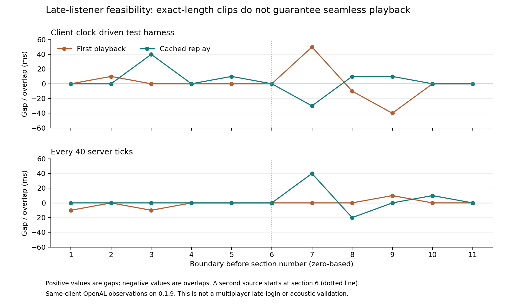

# Late-listener audio sections: feasibility result

**This experiment is not a released late-joining feature.** Its requirement was to let an arriving player hear the current part of a song without interrupting anyone already listening. The section-playback prototype does not establish that guarantee and has not been merged into the production branch or deployed to the server.

The Minecraft 26.3 packet classes and client sound definition contain no start-offset field. Sending the original sound again starts it from the beginning. The experiment therefore tested separate, exactly two-second audio files through ordinary server sound packets, with the unchanged vanilla sound engine.

## Results



| Scheduling | Pass | Largest gap | Largest overlap | Added-source spread |
| --- | --- | ---: | ---: | ---: |
| Client-clock-driven test harness | First playback | 50 ms | 40 ms | 0 ms |
| Client-clock-driven test harness | Cached replay | 40 ms | 30 ms | 0 ms |
| Every 40 server ticks | First playback | 10 ms | 10 ms | 0 ms |
| Every 40 server ticks | Cached replay | 40 ms | 20 ms | 0 ms |

Values are rounded native observations. Every native buffer was exactly 2.000 seconds long, and median boundary error was zero in each pass. Nonzero gaps and overlaps were still present when the server scheduled the packets itself. Exact file lengths, cached decoding and a regular server schedule did not ensure that the client's next source started when the previous source ended.

The second source started on the same native clock as the first at each observed boundary. **That is a same-client source-alignment result, not proof of synchronization between players.** The probe adds a second positional source at section 6 to one instrumented client. It does not log a second player in, measure network asymmetry, perform acoustic capture or test the full listener-admission lifecycle. Tone frequencies change between sections intentionally; the experiment measures timing, not perceived musical quality.

Both successful attempts used Java 25.0.5 with normal JIT settings, a 2 GiB heap and no debugger or diagnostic flags. A separate attempt exited with native code `0xc0000005` during startup before producing measurements. It remains in the [complete attempt audit and raw observations](data/late-join-sections.json) and contributes no timing samples. The production code tested was Copper Speakers 0.1.9 at commit `2d6146c11b98acf6eda022f38199edc3fa5ff22b`.

## Why this is not the requested fix

The existing full-track path starts one continuous sound per voice. Replacing that with recurring short sounds changes the playback path for current listeners, even if a new arrival does not trigger a group-wide restart. The measured discontinuities mean that this prototype should not be advertised as preserving uninterrupted playback.

Keeping existing listeners on their original whole-track sound introduces another problem: the server cannot observe when each vanilla client actually finished decoding and started playing. In 26.3, `SoundEngine.loadLibrary()` launches audio preloading asynchronously and does not wait for its future, so resource-pack acceptance is not an acknowledgement that audio buffers are ready. The current mod's 0.1.9 benchmarks measure source alignment within one client; they do not establish a shared playhead across different clients.

The project requires unmodified clients: a client mod is outside the accepted design. The [prepared-tail investigation](late-join-tails.md) explores sending only the newcomer a continuous cropped track while existing channels keep playing. This experimental branch leaves all production gameplay and playback code unchanged.

## Reproduction

With Java 25, the pinned local runtime from the development guide, Python and FFmpeg with libvorbis:

```powershell
python tools/generate-section-fixture.py
./gradlew.bat prepareRuns
python tools/run.py sections --name sections-my-attempt --heap 2G
```

The current harness uses one section every 40 server ticks. The first measurement used an earlier client-clock-driven harness and is retained for comparison; its scheduling code is not the current test implementation. The test performs 12 sections twice: first playback, then cached replay. Section resources are generated into `build/generated/section-probe` and are included only in the GameTest source set. No test audio is included in the production jar.

To redraw the published graph from the committed observations:

```powershell
python -m pip install matplotlib==3.10.9
python tools/plot-section-probe.py
```

The graph script checks each boundary error against the recorded source-start times and native buffer duration before plotting. Reports and launch logs from new attempts stay under `build/validation/`.
