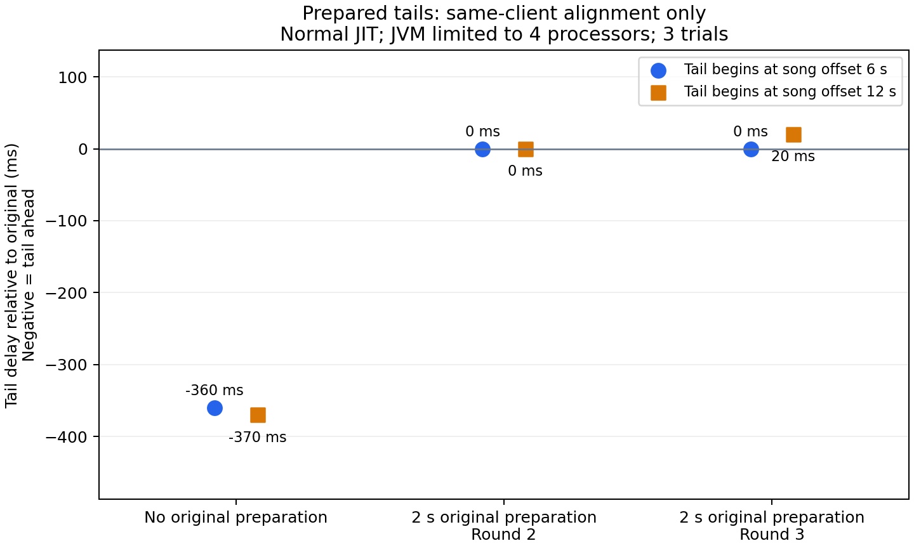

# Prepared audio tails for late listeners

**Research only: no late-listener feature has been merged or deployed.** The accepted design is a server-side mod with a resource pack and unmodified clients. Arriving listeners should join the current part of the song after a short wait, and existing listeners must keep their continuous playback. A client mod is outside scope.

This probe tests a different approach from [repeated sections](late-join-feasibility.md): leave the original full track playing, and send only an arriving listener a single continuous file cropped to a future song position. The probe uses Cat tails beginning at 6 and 12 seconds. It sends ordinary sound packets to prepare each tail inaudibly two seconds before its scheduled start. Preparation is a request, not a client readiness acknowledgement.

## Observations



| Trial | Original preparation lead | 6-second tail alignment | 12-second tail alignment | Existing sources unchanged |
| --- | ---: | ---: | ---: | --- |
| 1 | None | 360 ms ahead | 370 ms ahead | Yes |
| 2 | 2 seconds | Approximately aligned | Approximately aligned | Yes |
| 3 | 2 seconds | Approximately aligned | 20 ms behind | Yes |

Values are rounded observations from one completed timing run, not a precision guarantee. The original channel and buffer IDs remained the same, its playback offset advanced, and its inferred start stayed within the probe's 2 ms continuity tolerance. The first tail also continued unchanged when the second tail was added. Preparing the original reduced the observed mismatch in this small sample, but the two prepared trials still included a 20 ms error.

**These are same-client measurements.** All three sounds play on one instrumented client; the probe does not connect a second player. It measures OpenAL source clocks without seeking or altering the vanilla sound scheduler. It does not exercise login, dimension changes, network asymmetry, real pack downloading or production listener admission. In particular, it cannot prove that two different clients finish preparing at the same time.

The completed timing run used Zulu Java 25.0.5, normal tiered JIT compilation, a 2 GiB heap and **`-XX:ActiveProcessorCount=4`** on a machine with 12 logical processors. That restriction is part of the experiment and prevents treating it as an unrestricted-machine performance result. Four prior unrestricted attempts failed with native access violation `0xc0000005` during client startup, before measurements; one used Temurin Java 25.0.4.1. A separate diagnostic run with tier-1 JIT and four processors passed three continuity trials, but intentionally recorded no timing samples. All six attempts are retained in the [data and launch audit](data/late-join-tails.json).

## Resource-pack cost

Providing a continuous tail at every possible entry point duplicates the remaining audio. A projection using the original average compressed bitrate of each of the 22 vanilla record assets gives:

| Entry-point spacing | Projected additional audio |
| --- | ---: |
| 2 seconds | 1.64 GiB |
| 5 seconds | 663 MiB |
| 10 seconds | 323 MiB |

This is a storage projection, **not a generated pack size**. It excludes original tracks, custom songs, ZIP overhead and changes in bitrate caused by re-encoding. The original 22 assets total 32.7 MiB. Longer spacing reduces duplication but increases the possible joining wait; preparation time is additional. The probe generated only two tails, verified their exact decoded sample counts, and kept that audio in ignored development resources.

## Remaining work before this could be a feature

The server still has no vanilla-client acknowledgement that a decoded buffer is ready, and it cannot observe the actual start of the existing listener's sound. A fixed two-second preparation period may be too short on another client. Server-tick scheduling also needs evaluation under lag against audio's real-time clock. The same-client results do not establish synchronization between players.

This approach additionally needs a practical pack-delivery and caching design, audio preparation for arbitrary registered custom songs, per-session sound ownership, and tests across separate clients and network conditions. The probe's event-wide stop packets are isolated test operations; using those unchanged in production could stop another network playing the same sound on the arriving client. Generating or reloading a pack on demand also needs investigation of its effect on that client's other active sounds.

Prepared tails are therefore a promising server-only experiment, not a validated solution for every disc or listener. The production playback implementation remains unchanged.

## Reproduction

With Java 25, the pinned local runtime, Python, FFmpeg/libvorbis and ffprobe:

```powershell
python tools/generate-tail-fixture.py
./gradlew.bat prepareRuns
# Match the completed timing experiment's explicit processor restriction:
python tools/run.py tails --name tails-my-attempt --heap 2G --processors 4
# Functionality only; intentionally omits timing observations:
python tools/run.py tails --name tails-my-functional-attempt --heap 2G --diagnostic
python tools/estimate-tail-pack.py
python -m pip install matplotlib==3.10.9
python tools/plot-tail-probe.py
```

Omit `--processors 4` to attempt an unrestricted timing run. Attempt names must be new; logs and reports stay under `build/validation/`. The plot regenerates the committed figure and checks alignment values against the committed native clocks. Generated music and observation classes are excluded from the release jar.
