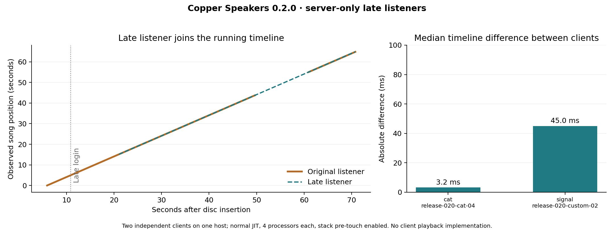

# Copper Speakers 0.2.0: separate-client late listeners

The packaged server mod admits a new listener to the running song without restarting existing listeners. These measurements use two independent Minecraft audio engines on a loopback server. A separate untouched-client check verifies that no client mod is required.



| Recording | Late-login timeline difference | Dimension-return difference | Existing source continuous |
| --- | ---: | ---: | --- |
| minecraft:music_disc.cat | 3.2 ms | 23.0 ms | Yes |
| test_records:signal | 45.0 ms | Not exercised | Yes |

Differences are absolute differences between median inferred song epochs, not acoustic latency or a guarantee for other machines. Each row is one completed run, not a statistical estimate of reliability. Both use release JAR SHA-256 `6ed493e25fc88f5f0f206e2e4d3f1919020214b668155d1e228389ca60225327`.

## What was checked

- A joins before insertion; B connects later, downloads the active track's pack and receives a nonzero-offset continuous suffix. A's source, buffer, event and native start remain unchanged.
- B begins outside the whole network at 256 blocks, then enters listening range. Playback is already advancing.
- A fourth-position speaker is connected during playback and is observed playing for both clients. Another speaker is disconnected. All sources stop after removing the main jukebox.
- The Cat run additionally starts and stops a separate network using the same song, cancels another network during preparation, and sends A to another dimension and back. B's original playback remains continuous.
- The custom fixture is a normal registered `jukebox_song` assigned with `jukebox_playable`, with an arbitrary sound-event identifier and no buffered alias or external music service.

The harness requires between-client and dimension-return differences below 100 ms, within-client source spread below 25 ms, and less than 2 ms variation in each uninterrupted source's inferred native start. These are validation thresholds, not product guarantees. [Raw observations](observations.json) retain source IDs, buffer IDs, events, frame counts, clock samples, runtime flags, catalogue hashes and production-source fingerprints.

The [untouched-client result](unmodified-client.json) uses the publisher's Minecraft jar, without Fabric or observation code. Windows' audio-session meter, filtered to that launched process, found zero signal outside range, a nonzero record signal nearby and zero signal after stopping. It records no audio and supplies no synchronization measurement.

## Decoder verification

Minecraft 26.3's own JOrbis decoder verified **1,696 entry points across 45 recordings**: all 22 vanilla discs, 22 additional custom recordings and the synthetic fixture. Every suffix has the expected decoded frame count, and samples after its short codec lead-in match the corresponding full recording exactly. The maximum observed lead-in is 448 frames. This leaves a small possible startup transient, not repeated gaps throughout a song. [Aggregate decoder receipts](decoder-verification.json) are separate from playback timing measurements; private recordings are not included.

## Environment and limits

Intel Core i5-12450H, 16 GB RAM, Windows 11; Zulu Java 25.0.5, Fabric Loader 0.19.5, Fabric API 0.163.0+26.3 and Polymer 0.18.4+26.3. Each observing client uses a 1 GiB maximum heap; the dedicated server uses 768 MiB. Each JVM exposes four processors. Both timing runs use normal tiered JIT compilation. Clients use `-XX:+UnlockDiagnosticVMOptions -XX:+AlwaysPreTouchStacks` to avoid native stack-commit failures found on this test workstation. These are recorded test-runtime flags, not requirements for players.

The observing clients contain test instrumentation that reads native OpenAL state; it does not seek, schedule or change playback. The production mod runs from the release jar. Native source clocks are compared through this host's monotonic clock, not through a network clock-synchronization protocol. Output-device latency, physical sound propagation, Internet latency and asymmetric frame stalls are not measured. Vanilla clients do not report actual audio start time, so the server cannot guarantee sample-accurate synchronization or correct a listener that stalls after admission.

Prepared joining requires a dedicated server and generated audio packs. Ordinary single-player playback and walking into range remain supported. See [setup, storage costs and gameplay limits](../../late-listeners.md).

## Failed attempts and corrections

The [complete implementation-stage attempt audit](attempts.json) retains unsuccessful and preliminary runs. Early runs exposed fixture configuration errors, native JVM startup failures and a Vorbis lead-in mismatch. A native allocation failure prompted smaller isolated runtime heaps. Two later packaged runs failed the alignment threshold (about 1.7 seconds and 264 ms) because first-use server work happened after the planned clock began. The final implementation grants preparation time after warm-up sends, anchors the initial timeline after packet construction, and reschedules newcomers whose admission deadline was missed.

Earlier successful development runs are retained in the audit but excluded from this release figure. Their late-attachment fixture was also found not to connect the additional speaker; the final fixture includes a wire bypass and explicitly asserts playback at the new position. Failed attempts contribute no samples to the passing-run figure, and are not represented as successful performance results.

The current source also passed 43 server GameTests and four JUnit tests. The 43-test functional run used tier-1 JIT and four exposed processors; it is not part of these timing measurements. The release audit found no music recordings or test classes in the mod jar. A concurrent Gradle test launch encountered an occupied test-world lock; the completed isolated functional run supplies the 43-test result.

## Reproduce

With Java 25, Python, NumPy, matplotlib, FFmpeg and ffprobe, and the local runtime prepared as described in [Development](../../development.md):

```sh
./gradlew build prepareRuns
python tools/prepare-join-audio.py --output build/my-cat --vanilla cat
python tools/verify-join-audio.py build/my-cat
python tools/check-multiclient-audio.py --name my-cat-01 --catalog build/my-cat --extended --packaged --pretouch-stacks --client-heap 1G --server-heap 768M
ffmpeg -f lavfi -i "sine=frequency=440:sample_rate=22050:duration=60" -af volume=0.1 -c:a libvorbis build/signal.ogg
python tools/prepare-join-audio.py --output build/my-custom --song test_records:signal=build/signal.ogg
python tools/check-multiclient-audio.py --name my-custom-01 --catalog build/my-custom --sound test_records:signal --packaged --pretouch-stacks --client-heap 1G --server-heap 768M
python tools/plot-join-benchmarks.py build/validation/my-cat-01 build/validation/my-custom-01
```

Use a new attempt name each time. Add `--vanilla-smoke` on Windows after `python -m pip install --target build/audio-meter pycaw`; the separate untouched client uses a 2 GiB heap. The figures can also be regenerated from the committed data alone with `python tools/plot-join-benchmarks.py`.
